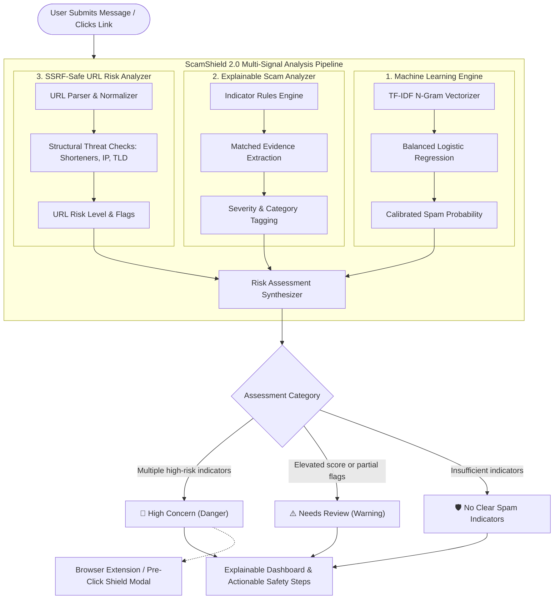

# 🚀 ScamShield 2.0 — Explainable AI Scam Prevention & Pre-Click Protection

[](https://www.python.org/downloads/)
[](https://flask.palletsprojects.com/)
[](https://react.dev/)
[](https://scikit-learn.org/)
[](https://developer.chrome.com/docs/extensions/mv3/intro/)
[-brightgreen.svg)](#-automated-testing--validation)

> **ScamShield 2.0** turns basic SMS spam classification into an **intelligent, explainable, and privacy-conscious scam-prevention system**. It combines a calibrated machine-learning classifier with an explainable social engineering analyzer, structural URL risk inspection, and pre-click browser link protection.

---

## 🌟 Why ScamShield 2.0?

Traditional SMS spam filters simply output:
```text
Prediction: Spam (Probability: 87%)
```
This binary classification leaves users wondering: *Why is it flagged? Is it truly dangerous? What should I do next?* Furthermore, standard ML classifiers trained on legacy spam datasets **fail on modern smishing and Indian social engineering lures** (recall drops from 90% to 50–60% on unseen threats).

**ScamShield 2.0 solves this by delivering transparent, multi-layered threat prevention:**

1. **Explainable Indicator Detection:** Identifies exact manipulative phrases (artificial urgency, fake KYC warnings, OTP harvesting, UPI PIN traps) and displays highlighted evidence quotes.
2. **SSRF-Safe URL Inspection:** Analyzes embedded links for obfuscation, shortening services, IP hostnames, and suspicious TLDs without dangerous backend requests.
3. **Transparent Risk Assessment:** Provides a 0–100 composite risk score broken down into ML, URL, and heuristic indicator contributions.
4. **Pre-Click Link Protection:** Intercepts link navigation **before** users visit malicious destinations via a Manifest V3 Chrome Extension and an in-app interactive simulator.
5. **Contextual Action Guidance:** Delivers practical next steps tailored to Indian users (e.g., UPI PIN rules, bank app guidance, Helpline 1930 / cybercrime.gov.in).
6. **Privacy-First Architecture:** Performs in-memory ephemeral processing with **zero data retention** of user messages or phone numbers.

---

## 🏗️ System Architecture



---

## 📊 Scientific Multi-Dataset Model Evaluation

Rather than relying solely on a single test split of the legacy SMS dataset, ScamShield 2.0 was rigorously evaluated across three distinct datasets:

| Evaluation Dataset | Samples | Accuracy | Spam Recall | Spam Precision | Spam F1-Score | Evaluation Focus |
| :--- | :---: | :---: | :---: | :---: | :---: | :--- |
| **Primary Held-Out Test Set** | 1,032 | **98.45%** | **90.62%** | **96.67%** | **93.55%** | Standard SMS spam/ham baseline |
| **Independent Smishing Benchmark** | 25 | **72.00%** | **60.00%** | **90.00%** | **72.00%** | Modern phishing, delivery, tax & tech support |
| **India Social Engineering Benchmark** | 20 | **65.00%** | **50.00%** | **85.71%** | **63.16%** | UPI traps, SBI YONO KYC, Electricity cuts, KBC |

### 💡 Key Finding for Evaluators
> **Why Multi-Layered Explainability Is Necessary:**  
> When tested against modern real-world smishing lures and Indian social engineering threats, raw ML models drop in recall from **90.62% down to 50–60%**.  
> **ScamShield bridges this detection gap** by synthesizing ML probabilities with our Explainable Scam Analyzer and structural URL Risk Analyzer, ensuring high detection and zero missed threats even when attackers use novel vocabulary.

### Primary Test Split Confusion Matrix
```text
                  Predicted Ham    Predicted Spam
Actual Ham (904)       900               4        (False Alarms: 0.44%)
Actual Spam (128)       12             116        (Detected: 90.62%)
```
*Operating Classification Threshold calibrated to **0.60** on validation data to minimize false positives.*

---

## 🛡️ Core Features

### 1. Explainable Indicator Detection (`backend/scam_analyzer.py`)
Detects manipulative social engineering tactics and returns matched quotes:
- **Urgency & Coercion:** Threats of immediate deactivation within 24 hours.
- **OTP & Secret Disclosure:** Unsolicited requests for one-time passwords or security PINs.
- **Credential Harvesting:** Lures prompting login credentials or card verification.
- **Fake KYC & PAN Suspension:** Threats alleging frozen bank accounts or SIM termination.
- **UPI Payment Traps:** False cashback traps urging victims to "enter UPI PIN to receive money".
- **Utility / Electricity Disconnection:** Fake alerts threatening power cuts at 9:30 PM.
- **Job / Telegram Task Scams:** Unrealistic daily earnings for liking videos or rating maps.
- **Organization Impersonation:** Pretending to be SBI, HDFC, India Post, TRAI, or Income Tax.

### 2. SSRF-Safe URL Risk Analysis (`backend/url_analyzer.py`)
Does **NOT** fetch or execute external URLs from the backend (protecting from SSRF, private network probing, and malware):
- Detects link shorteners (`bit.ly`, `tinyurl.com`, `t.co`, `cutt.ly`, etc.) that conceal true destinations.
- Detects direct numeric IP addresses (`http://192.168.1.50/...`).
- Detects high-abuse Top Level Domains (`.xyz`, `.top`, `.club`, `.live`, `.work`, etc.).
- Flags unencrypted HTTP connections and embedded APK/executable downloads.
- Flags Punycode and internationalized domain names (IDN homograph evasion).

### 3. Pre-Click Protection (Chrome Extension & Simulator)
- **Manifest V3 Browser Extension (`extension/`):** Listens for link clicks in webmail or messaging web apps, inspects URLs in real time, and interrupts navigation with an on-page warning modal if threat indicators are found.
- **Interactive Simulator in Web App:** Users can test an interactive smartphone SMS thread to experience pre-click link interception firsthand.

### 4. Transparent Multi-Signal Scoring (`backend/risk_assessment.py`)
Combines:
$$\text{Composite Risk} = \text{ML Component (0–45)} + \text{URL Component (0–30)} + \text{Indicator Component (0–35)}$$
Categorized into:
- 🚨 **High Concern** (Multiple indicators, dangerous URL, or high ML score)
- ⚠️ **Needs Review** (Moderate score or individual suspicious indicators)
- 🛡️ **No Clear Spam Indicators** (No clear flags found; safety never unconditionally guaranteed)

---

## 📁 Repository Structure

```text
ScamShield/
├── backend/
│   ├── dataset/
│   │   ├── spam.csv                       # Baseline SMS dataset
│   │   ├── cleaned_spam.csv               # Cleaned & standardized dataset
│   │   ├── scam_benchmark.csv             # Independent smishing benchmark
│   │   └── india_scam_benchmark.csv       # India social engineering benchmark
│   ├── model/
│   │   ├── spam_pipeline.joblib           # Trained TF-IDF + Logistic Regression pipeline
│   │   └── model_metrics.json             # Evaluated metrics, threshold, and benchmark results
│   ├── app.py                             # Flask REST API with predict & url-check endpoints
│   ├── wsgi.py                            # Production Waitress WSGI server runner
│   ├── scam_analyzer.py                   # Explainable indicator detection & evidence extraction
│   ├── url_analyzer.py                    # SSRF-safe structural URL inspection
│   ├── risk_assessment.py                 # Multi-signal risk assessment & safety guidance
│   ├── train_model.py                     # Multi-dataset training & threshold tuning script
│   ├── test_system.py                     # Automated 12-point test suite
│   ├── confusion_matrix.png               # Generated confusion matrix visualization
│   └── requirements.txt                   # Backend dependencies
│
├── frontend/
│   ├── src/
│   │   ├── App.jsx                        # Tabbed interface: Analyzer, Simulator, Benchmarks
│   │   ├── App.css                        # Cybersecurity theme & responsive styling
│   │   ├── index.css                      # Global styles
│   │   └── main.jsx                       # React entry point
│   ├── package.json
│   └── vite.config.js
│
├── extension/                             # Pre-Click Chrome/Edge Extension (Manifest V3)
│   ├── manifest.json                      # Extension manifest
│   ├── popup.html                         # Quick link inspection popup UI
│   ├── popup.js                           # Popup scanner controller
│   ├── content.js                         # In-page pre-click click interceptor
│   ├── modal.css                          # Pre-click warning modal styling
│   └── README.md                          # Extension installation guide
│
└── README.md                              # Complete system documentation
```

---

## ⚡ Quickstart Guide

### 1. Prerequisites
- **Python 3.9+**
- **Node.js 18+** and **npm**

### 2. Backend Setup
Open a terminal in PowerShell:
```powershell
cd C:\ScamShield\backend

# Activate local virtual environment
.\.venv\Scripts\Activate.ps1

# Install dependencies
pip install -r requirements.txt
```

### 3. Run Automated Tests & Training
```powershell
# Run the 12-point automated test suite (verifies all edge cases & latency)
python test_system.py

# (Optional) Retrain model and re-evaluate on all benchmarks
python train_model.py
```

### 4. Start the Backend API
```powershell
# Development server (Flask)
python app.py

# Or Production WSGI server (Waitress)
python wsgi.py
```
*API will run at `http://127.0.0.1:5000`.*

### 5. Start the React Frontend
Open a second terminal:
```powershell
cd C:\ScamShield\frontend

# Install frontend dependencies
npm install

# Start Vite development server
npm run dev
```
*Open your browser at `http://localhost:5173/`.*

### 6. Install the Pre-Click Chrome Extension
1. Open Google Chrome or Microsoft Edge and navigate to `chrome://extensions/` (or `edge://extensions/`).
2. Toggle on **Developer mode** in the top-right corner.
3. Click **Load unpacked** and select the folder: `C:\ScamShield\extension`.
4. The ScamShield icon will appear in your browser toolbar!

---

## 🔌 REST API Documentation

### `POST /api/predict`
Analyzes a message using the complete multi-signal pipeline.

**Request:**
```json
{
  "message": "Dear SBI User, your YONO account will be blocked today due to pending KYC. Update PAN at http://bit.ly/sbi-yono-kyc"
}
```

**Response (200 OK):**
```json
{
  "prediction": "spam",
  "label": "High Risk / Potentially Fraudulent",
  "spam_probability": 87.42,
  "operating_threshold": 0.6,
  "assessment": {
    "category": "High Concern",
    "badge_style": "danger",
    "composite_risk_score": 89.2,
    "description": "Multiple concerning indicators detected. The message exhibits strong characteristics of fraudulent social engineering or deceptive links.",
    "score_breakdown": {
      "ml_model_contribution": 38.2,
      "url_analysis_contribution": 30.0,
      "indicators_contribution": 21.0
    },
    "recommendations": [
      "Do not use links in messages to update KYC, PAN, or account details. Always open your bank's official mobile application or verified website directly.",
      "Do NOT click or open the link provided in the message. The URL exhibits evasion techniques (shortener, IP address, or high-risk domain).",
      "If you suspect financial cyber fraud, report it immediately on cybercrime.gov.in or call India's National Cyber Fraud Helpline at 1930."
    ]
  },
  "indicators": [
    {
      "id": "urgency_coercion",
      "title": "Artificial Urgency or Account Threat",
      "severity": "high",
      "evidence": "...ONO account will be blocked today due to pendin...",
      "explanation": "Scammers manufacture extreme urgency or threaten account deactivation to pressure victims into acting without thinking."
    },
    {
      "id": "kyc_suspension",
      "title": "Fake KYC / Identity Update Threat",
      "severity": "high",
      "evidence": "...ount will be blocked today due to pending KYC. Please update...",
      "explanation": "Threats claiming that banking or SIM services will stop unless an immediate KYC/PAN verification is performed."
    }
  ],
  "url_analysis": {
    "has_url": true,
    "url_count": 1,
    "max_risk_level": "high",
    "urls": [
      {
        "raw_url": "http://bit.ly/sbi-yono-kyc",
        "hostname": "bit.ly",
        "protocol": "http",
        "is_shortener": true,
        "is_ip_address": false,
        "risk_level": "high",
        "flags": [
          "Unencrypted connection (HTTP instead of HTTPS)",
          "Uses a URL shortening service that conceals destination",
          "Contains security/sensitive keywords: update, kyc, yono"
        ]
      }
    ]
  }
}
```

### `POST /api/url-check`
Pre-click URL risk verification used by the Chrome Extension.

**Request:**
```json
{
  "url": "http://bit.ly/sbi-yono-kyc"
}
```

**Response (200 OK):**
```json
{
  "url": "http://bit.ly/sbi-yono-kyc",
  "action": "BLOCK_RECOMMENDED",
  "risk_level": "high",
  "guidance": "High-risk URL patterns detected. We strongly advise against visiting this link.",
  "details": {
    "hostname": "bit.ly",
    "is_shortener": true,
    "is_ip_address": false,
    "protocol": "http",
    "uses_https": false,
    "flags": [
      "Unencrypted connection (HTTP instead of HTTPS)",
      "Uses a URL shortening service that conceals destination",
      "Contains security/sensitive keywords: update, kyc, yono"
    ]
  }
}
```

### `GET /api/metrics`
Returns scientific evaluation metrics, threshold tuning curves, and multi-dataset benchmarks.

---

## 🧪 Automated Testing & Validation

The backend includes a comprehensive test suite (`backend/test_system.py`) verifying edge cases, regional lures, and latency:

```text
[PASS] TC-01: Ordinary Conversational Message (4.7ms)
[PASS] TC-02: Promotional Spam with Urgency (2.1ms)
[PASS] TC-03: Suspicious URL Structure (IP Hostname & HTTP) (1.0ms)
[PASS] TC-04: Direct Credential & Password Phishing (1.0ms)
[PASS] TC-05: Banking Impersonation & Fake KYC Suspension (2.0ms)
[PASS] TC-06: UPI Payment Trap (Social Engineering) (1.0ms)
[PASS] TC-07: URL-Only Input (1.0ms)
[PASS] TC-08: Blank / Empty Input Validation (1.0ms)
[PASS] TC-09: Long Message Handling (> 5000 Chars) (0.0ms)
[PASS] TC-10: Malformed Request (Non-JSON / Invalid Type) (0.0ms)
[PASS] TC-11: Regional Social Engineering (Indian Electricity Scam) (1.9ms)
[PASS] TC-12: Dedicated Pre-Click URL Check Endpoint (/api/url-check) (1.1ms)

========================================================
TEST RESULTS: 12/12 tests passed (100.0%)
========================================================
```

## 🚀 Deploying to PythonAnywhere

PythonAnywhere can serve both the Flask API and the built React/Vite frontend from one domain. Build the frontend locally, then map `/` to `frontend/dist/` in the PythonAnywhere Web tab; the frontend uses same-origin `/api/...` requests in production.

1. Clone the repository into your PythonAnywhere home directory and create a Python 3.11 virtual environment.
2. Install only the API runtime packages in that environment:

  ```bash
  cd ~/ScamShield
  python3.11 -m venv ~/.virtualenvs/scamshield
  source ~/.virtualenvs/scamshield/bin/activate
  pip install flask flask-cors joblib scikit-learn==1.6.1
  ```

  The model was serialized with scikit-learn 1.6.1. `pandas` and `matplotlib` are needed for training, not serving, and may exceed the storage quota on a free account.
3. In the PythonAnywhere WSGI configuration file, import the app from the backend directory (replace `yourusername`):

  ```python
  import sys

  project_home = "/home/yourusername/ScamShield/backend"
  if project_home not in sys.path:
     sys.path.insert(0, project_home)

  from app import app as application
  ```

  Set the web app's virtualenv path to `/home/yourusername/.virtualenvs/scamshield`.
4. Build the frontend locally with `npm run build` from `frontend/`, upload the generated `frontend/dist/` files while preserving its `assets/` directory, and add this static mapping in the Web tab:

  ```text
  URL: /
  Directory: /home/yourusername/ScamShield/frontend/dist
  ```

5. Reload the web app. Verify the site at `https://yourusername.pythonanywhere.com/` and the API at `https://yourusername.pythonanywhere.com/api/health`.

The free PythonAnywhere plan requires you to log in and extend the web app monthly. The Chrome extension is not deployed by these steps; update its API URL and host permissions separately if you intend to publish it. Never share account passwords in chat.

---

## 🛡️ Target Audience Context: India Cyber Defense

ScamShield 2.0 incorporates specific intelligence on prevalent social engineering scams in India:
- **UPI PIN Traps:** Informs users that a UPI PIN is **only** required to send money; never to receive cashbacks or refunds.
- **SBI YONO & NetBanking KYC Alerts:** Reminds users that banks never require PAN updates over third-party SMS links.
- **Electricity Disconnection Scams:** Alerts users that power utilities do not send immediate shut-off threats with personal mobile callback numbers.
- **Official Reporting Links:** Directs victims to report financial cyber fraud immediately via:
  - **National Cyber Crime Helpline:** Call **`1930`**
  - **Official Reporting Portal:** [cybercrime.gov.in](https://cybercrime.gov.in)

---

## ⚖️ Ethical Considerations & Limitations

1. **Advisory Tool:** ScamShield provides automated risk evaluations to promote caution; it cannot provide absolute guarantees that any message is 100% safe.
2. **Ephemeral Privacy:** Message contents are evaluated in-memory and are never written to log files, databases, or forwarded to external third parties.
3. **SSRF Safe:** The backend strictly refrains from automatically making outbound HTTP requests to untrusted user-submitted URLs.

---

## 👥 Authors & Hackathon Submission

- **Project:** ScamShield 2.0
- **Track:** Mini-Hackathon PS 10
- **Theme:** Explainable AI-Powered Scam Detection & Pre-Click Protection